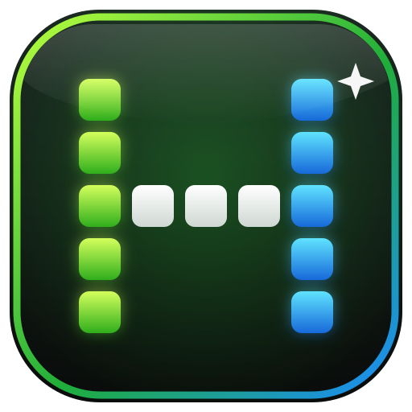

<p align="center"></p>

# Hollywood Arcade

A console-style front end for your PC. Steam, Epic, GOG, Ubisoft, Game Pass, emulators, apps, music, Jellyfin and streaming services in one controller-friendly place, with an Xbox 360 style Guide you can open over a game.

It is one `.exe`. Double-click it. No installer, no account, no background services.

> **Version 3.0 is the first official release.** It is free, open source and made by one person, so if something breaks, use **Settings > Health check > Copy report** and open an issue.

## Features
- **Home, Games, Apps** with covers, descriptions and play time, pulled from free sources.
- **Library import** from Steam, Epic, GOG, Ubisoft Connect, Game Pass and the Start menu, plus emulator game folders.
- **The Guide**: an Xbox 360 style menu with blades for Store, Games, Hollywood, Media, System and Settings. Hold L3 + R3 or hold the touchpad, even in a game.
- **Profiles** with separate play history, favourites, achievements, themes and accounts.
- **Achievements** from Steam, RetroAchievements and Xbox (experimental), plus Arcade's own badges.
- **Watch**: your Jellyfin library (ErsatzTV channels appear under Live TV) and a row of streaming services that open full screen and work with a controller.
- **System menu** for Wi-Fi, Bluetooth, display, sound, Windows Update, power mode and brightness.
- **Store** tab with Steam deals, Game Pass, a retro classics browser and emulators, including one-click install for several (experimental).
- Screensaver mode, sounds, on-screen keyboard, backups and restore, patch notes after every update.

## Download and run
Get `HollywoodArcade.exe` from the [Releases](../../releases) page.

**Windows will warn you the first time.** The program is not code-signed (a certificate costs money and this is a free hobby project), so Windows SmartScreen shows *"Windows protected your PC"*. Click **More info**, then **Run anyway**. Some antivirus programs also flag unsigned programs they have not seen before.

If you would rather not trust a download, you do not have to:
- Each release has a `.sha256` file. Compare it with `Get-FileHash HollywoodArcade.exe` in PowerShell.
- The release is built from this source by GitHub Actions (see `.github/workflows/release.yml`), so what you download matches what you can read.
- Or build it yourself, below.

Arcade needs Microsoft Edge (already on Windows 10 and 11) or Chrome. Your library is stored in `%APPDATA%\HollywoodArcade`.

## Privacy
Arcade runs a small web server that only listens on your own PC (127.0.0.1) and requires a private token. It has no analytics and sends nothing to its author. It contacts other services only for features you use:

| Feature | Talks to |
| --- | --- |
| Covers and descriptions | Steam, Epic, GOG, Wikipedia, Apple, Libretro thumbnails, and RAWG / SteamGridDB / IGDB if you add keys |
| Store | Steam and Microsoft store listings |
| Achievements | Steam, RetroAchievements, OpenXBL (only if you add the details) |
| Watch | your own Jellyfin server; streaming sites you open |
| Emulator install | GitHub releases of the emulator you choose |
| Updates | `api.github.com` and `github.com` release downloads for this project. Checked a few seconds after start-up (turn off in Settings); an update is only installed when you press **Update now**, and only if its SHA-256 matches the published checksum |

API keys are stored in `library.json` on your PC. Backups made with the normal **Back up** button leave keys out; **Back up with keys** includes them. Bug-report text hides your Windows user name and folders.

## Setting up achievements
- **Steam**: in Settings, enter your Steam ID and set your Steam profile's *Game details* to Public. A Web API key (steamcommunity.com/dev/apikey) is optional and more reliable.
- **RetroAchievements**: make a free account, then copy your user name and Web API key from your settings page there.
- **Xbox**: create a free key at xbl.io. Support is experimental and covers what that service exposes.

Achievement sources that need to read game save files (RPCS3 trophies, PSN, GOG, Epic) are not supported yet.

## Your own retro lists and emulators
Settings has **Open data folder**, which creates `retro.json` and `emulators.json` with examples. Edit them and restart Arcade.

## Building from source
Go 1.24 or newer, standard library only:

```
GOOS=windows GOARCH=amd64 go build -ldflags "-s -w -H=windowsgui" -o HollywoodArcade.exe .
```

See [CONTRIBUTING.md](CONTRIBUTING.md). On Linux or macOS you can run the web side for development with `HA_NOWINDOW=1 go run .`.

## Update check
Arcade updates itself from this project's GitHub releases (Settings → Updates). Every release publishes `HollywoodArcade.exe` and a `HollywoodArcade.exe.sha256` checksum; an update is installed only if the two match, and the previous version is put back automatically if the new one fails to start.

## Disclaimer
Hollywood Arcade is an independent project. It is not made by, or connected to, Microsoft, Sony, Nintendo, Valve, Epic Games, Apple or any service it can open. Names and pictures belong to their owners. Arcade does not download or provide games, ROMs or BIOS files; you supply your own.

## License
GPL-3.0-or-later. See [LICENSE](LICENSE). This program comes with no warranty.
